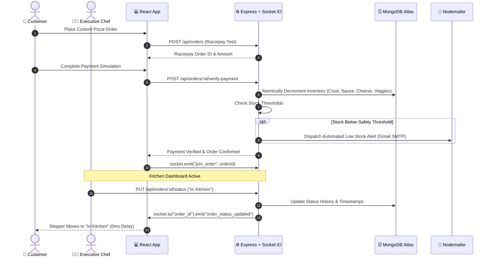

<div align="center">

# 🍕 PIZZERIA BELLA
### *Artisanal Neapolitan Hearth Pizza & Intelligent Real-Time Delivery Platform*

[](https://github.com/isahilkumar/PIZZERIA_BELLA)
[](https://react.dev/)
[](https://vitejs.dev/)
[](https://nodejs.org/)
[](https://expressjs.com/)
[](https://www.mongodb.com/)
[](https://socket.io/)
[](https://tailwindcss.com/)
[](https://razorpay.com/)

<p align="center">
  <b>A fullstack production-grade pizza ordering and kitchen management ecosystem.</b><br/>
  Featuring an interactive 2D canvas pizza visualizer, 4K wood-fired welcome portal, real-time WebSocket order tracking, automated atomic stock decrements, and scheduled low-stock email alerts.
</p>

[Explore Features](#-core-features) • [Quick Start](#-quick-start) • [Live Credentials](#-pre-seeded-test-credentials) • [Architecture](#-architecture) • [API Reference](#-api-endpoints) • [Deployment Guide](RENDER_DEPLOYMENT.md)

</div>

---

## 📸 Experience & Visual Showcase

```
                                      🍕 PIZZERIA BELLA 🍕
   ┌────────────────────────────────────────────────────────────────────────────────────────┐
   │                                                                                        │
   │   🌟 4K Cinematic Welcome Portal       🎨 Interactive 2D Visualizer Canvas             │
   │   • 100% Transparent Frosted Glass     • Step 1: 5 Artisanal Sourdough Bases           │
   │   • Real-Time Typewriter with Namaste  • Step 2: 5 Simmered San Marzano Sauces         │
   │   • 6 Native Landscape 4K Backdrops    • Step 3: 5 Melting Cheeses (Fior di Latte)     │
   │   • 0ms Instant Entrance Transition    • Step 4: 8 Fresh Farm Toppings & Veggies       │
   │                                                                                        │
   │   💳 Test Mode Razorpay Checkout       ⏱️ Live WebSocket Stepper Tracker               │
   │   • Subtotal + 5% GST + Free Delivery  • Order Received → In Kitchen                   │
   │   • Instant atomic stock deduction     • Sent to Delivery → Delivered                  │
   │                                                                                        │
   │   👨‍🍳 Executive Chef Command Center    🚨 Automated Stock Scanner & Cron               │
   │   • Restricted Frosted Glass Login     • Node-Cron automatic background scan           │
   │   • Real-time ingredient stock matrix  • Gmail SMTP / Ethereal instant alert emails    │
   │   • 1-Click kitchen order dispatcher   • Low stock warning threshold triggers          │
   │                                                                                        │
   └────────────────────────────────────────────────────────────────────────────────────────┘
```

---

## 🌟 Core Features

### 👤 Customer Experience
* **Cinematic Welcome Portal**: 100% transparent frosted-glass portal featuring dynamic typewriter animation (`Welcome to Pizzeria Bella 🙏` / `🙏 Namaste`), floating wood-oven embers, and smooth 4K Neapolitan photography backdrops.
* **Neapolitan Specialty Showcase**: Rich menu catalog of chef-curated pizzas (*Margherita Classica, Truffle Forest Mushroom, Pesto Garden Royale, Fiery Peri Peri*) with ingredient transparency and customizer entry points.
* **Interactive 2D Pizza Plate Visualizer**: As users select bases, sauces, cheeses, and vegetables, a custom canvas visualizer re-renders crust colors, simmered sauce coats, melted cheese textures, and scattered toppings in real-time.
* **4-Step Custom Pizza Builder**:
  * **Crusts**: Hand Tossed Thin Crust, Deep Dish Pan, Cheese Burst, Gluten-Free Cauliflower, Whole Wheat Sourdough.
  * **Sauces**: Classic San Marzano Tomato, Creamy Garlic Alfredo, Spicy Peri Peri Marinara, Basil Pesto Genovese, Smoky Chipotle BBQ.
  * **Cheeses**: Fior di Latte Mozzarella, Sharp Aged Cheddar, Creamy Whipped Ricotta, Vegan Mozzarella, Smoked Provolone & Gouda.
  * **Veggies**: Tricolor Bell Peppers, Kalamata Olives, Caramelized Onions, Pickled Jalapeños, Button Mushrooms, Cherry Tomatoes, Sweet Corn, Baby Spinach.
* **Streamlined Cart & Checkout**: Automatic subtotal, dynamic 5% GST, free delivery logic above ₹500, delivery address form, and Razorpay test gateway dialog.
* **Real-Time WebSocket Order Tracker**: Live 4-stage stepper tracking (`Order Received` → `In Kitchen` → `Sent to Delivery` → `Delivered`) updated instantly across devices via Socket.IO without page refreshes.
* **Full Authentication & Password Recovery**: Secure registration with email verification tokens, JWT authentication with 7-day cookies, and 60-minute password reset flows.

---

### 🛡️ Kitchen & Executive Chef Management
* **Dedicated Executive Chef Portal (`/admin/login`)**: Isolated administrative gate with frosted glass aesthetic, 3D tilt, and role-based route guards (`adminOnly`).
* **Real-Time Stock Inventory Matrix**: Full tracking of 23 distinct ingredients with safety threshold indicators, active badges (*In Stock*, *Low Stock*, *Out of Stock*), and rapid `+10` / `-5` quick adjustment controls.
* **Atomic Order Stock Decrement**: Placing and confirming an order atomically deducts the exact recipe quantities from MongoDB database inventory.
* **Automated Low-Stock Email Alerts**: Integrated **Node-Cron** background scanner periodically checks for depleted items (`stockQuantity < threshold`) and dispatches HTML alert reports to the administrator via Gmail SMTP or Ethereal sandbox.
* **Live Kitchen Dispatch Center**: Real-time order dispatch board allowing chefs to transition orders through their fulfillment lifecycle with immediate customer dashboard updates.
* **Email Audit Vault (`/admin/emails`)**: In-app inspection log displaying all sent verification codes, password resets, and stock alerts with 1-click preview links.

---

## 🔑 Pre-Seeded Test Credentials

Both login portals feature convenient **1-Click Auto-Fill** buttons for effortless evaluation:

| Portal | Role | Email | Password | Access URL |
| :--- | :--- | :--- | :--- | :--- |
| **Kitchen Command** | Executive Chef | `admin@pizzadelivery.com` | `Admin@123456` | [http://localhost:5173/admin/login](http://localhost:5173/admin/login) |
| **Customer Portal** | Verified User | `user@example.com` | `User@123456` | [http://localhost:5173/login](http://localhost:5173/login) |

---

## 🚀 Quick Start

### 1. Prerequisites
- **Node.js** (v18.x or v20.x recommended)
- **MongoDB** (Local instance on `mongodb://127.0.0.1:27017` or [MongoDB Atlas](https://www.mongodb.com/atlas))
- **Git**

### 2. Clone Repository
```bash
git clone https://github.com/isahilkumar/PIZZERIA_BELLA.git
cd PIZZERIA_BELLA
```

### 3. Backend Setup
```bash
cd backend
npm install

# Configure environment variables
cp .env.example .env

# Seed database with initial pizzas & inventory
node src/seed.js

# Start backend server
npm start
# -> Backend active on http://localhost:5000
```

### 4. Frontend Setup
```bash
cd ../frontend
npm install

# Start Vite dev server
npm run dev
# -> Frontend active on http://localhost:5173
```

---

## 🧪 Automated Test Suite

The platform includes a 23-point automated integration test suite validating authentication, pizza customizer recipes, order state machine, stock decrements, and email alerts:

```bash
cd backend
node test-suite.js
```

```
============================================================
🎉 TEST SUITE COMPLETE: 23 PASSED, 0 FAILED (100% HEALTHY)
============================================================
```

---

## 🏗️ Architecture & Directory Structure

```
PIZZERIA_BELLA/
├── .gitignore                         # Comprehensive secrets & build exclusion rules
├── README.md                          # Master documentation & visual guide
├── RENDER_DEPLOYMENT.md               # 1-click cloud deployment guide for Render
│
├── backend/                           # Node.js + Express.js API & WebSocket Server
│   ├── .env.example                   # Safe environment template
│   ├── server.js                      # Root server entry point
│   ├── test-suite.js                  # 23-step automated E2E integration test
│   └── src/
│       ├── config/db.js               # MongoDB Mongoose connection handler
│       ├── controllers/
│       │   ├── authController.js      # JWT login, registration, email verify, password reset
│       │   ├── inventoryController.js # Real-time stock levels, manual editor & alert status
│       │   ├── orderController.js     # Order placement, Razorpay verification & stock decrements
│       │   └── pizzaController.js     # Specialty pizza varieties catalog
│       ├── middleware/
│       │   └── authMiddleware.js      # JWT verification & admin-only route protection
│       ├── models/
│       │   ├── InventoryItem.js       # Bases, sauces, cheeses, vegetables schema with thresholds
│       │   ├── Order.js               # Orders schema, payment status, timeline history
│       │   ├── PizzaVariety.js        # Signature menu items schema
│       │   └── User.js                # Users and admins schema with hashed tokens
│       ├── routes/                    # Express REST route definitions
│       ├── services/
│       │   └── stockAlertService.js   # Node-Cron scheduled background scanner & alert dispatcher
│       └── utils/
│           └── mailer.js              # Nodemailer transporter & responsive HTML email templates
│
└── frontend/                          # React 18 + Vite Single Page Application
    ├── index.html                     # HTML5 entry with bold font weights
    ├── tailwind.config.js             # Custom colors, shadows, and keyframe animations
    ├── vite.config.js                 # Vite bundler configuration
    └── src/
        ├── api/                       # Axios instance with JWT interceptors & Socket.IO client
        ├── components/
        │   ├── BrandLogo.jsx          # Neapolitan sourdough pizza vector emblem
        │   ├── Navbar.jsx             # Responsive glassmorphic navigation header
        │   ├── Footer.jsx             # Footer with quick links and admin access
        │   ├── PizzaPlateVisualizer.jsx# Dynamic 2D canvas pizza visualizer
        │   └── WelcomeLanding.jsx     # 4K wood-fired welcome portal with typewriter & 3D tilt
        ├── context/
        │   ├── AuthContext.jsx        # User & admin session state
        │   └── CartContext.jsx        # Persistent cart state & pricing calculators
        └── pages/
            ├── Home.jsx               # Signature pizza showcase with welcome gate
            ├── CustomBuilder.jsx      # 4-step custom pizza creation studio
            ├── CartSummary.jsx        # Order review & Razorpay checkout modal
            ├── OrderDetails.jsx       # Real-time WebSocket order tracking stepper
            ├── MyOrders.jsx           # Customer past orders history
            ├── Login.jsx / Register.jsx# Customer authentication
            ├── ForgotPassword.jsx     # Password reset flow
            ├── Welcome.jsx            # Standalone welcome portal route
            └── admin/
                ├── AdminLogin.jsx     # Isolated Executive Chef login portal
                ├── AdminLayout.jsx    # Glassmorphic admin navigation tabs & auth guard
                ├── AdminInventory.jsx # Inventory stock levels & manual stock editor
                ├── AdminOrders.jsx    # Live kitchen dispatch & order timeline controller
                └── AdminEmails.jsx    # Audit vault of sent notifications with preview links
```

---

## 📡 API Endpoints

### 🔐 Authentication (`/api/auth`)
| Method | Endpoint | Access | Description |
| :--- | :--- | :--- | :--- |
| `POST` | `/api/auth/register` | Public | Register new customer & dispatch verification token |
| `GET` | `/api/auth/verify-email/:token` | Public | Verify customer email address |
| `POST` | `/api/auth/login` | Public | Customer login & return JWT token |
| `POST` | `/api/auth/admin/login` | Public (Restricted) | Admin login & verify executive role |
| `POST` | `/api/auth/forgot-password` | Public | Dispatch password reset email link |
| `POST` | `/api/auth/reset-password/:token` | Public | Reset password with token |

### 🍕 Pizza Catalog (`/api/pizzas`)
| Method | Endpoint | Access | Description |
| :--- | :--- | :--- | :--- |
| `GET` | `/api/pizzas` | Public | Get all signature specialty pizzas |
| `GET` | `/api/pizzas/:id` | Public | Get detailed recipe of a single pizza |

### 📦 Inventory & Stock Alerts (`/api/inventory`)
| Method | Endpoint | Access | Description |
| :--- | :--- | :--- | :--- |
| `GET` | `/api/inventory` | Public / User | Fetch all available pizza bases, sauces, cheeses & veggies |
| `POST` | `/api/inventory` | Admin | Create new inventory ingredient item |
| `PUT` | `/api/inventory/:id` | Admin | Update ingredient stock quantity or safety threshold |
| `POST` | `/api/inventory/check-alerts` | Admin | Trigger on-demand low stock check & send email alert |
| `GET` | `/api/inventory/alert-status` | Admin | Fetch last alert timestamp and sent notification logs |

### 🛒 Orders & Live Tracking (`/api/orders`)
| Method | Endpoint | Access | Description |
| :--- | :--- | :--- | :--- |
| `POST` | `/api/orders` | Customer | Create new order & initialize Razorpay payment transaction |
| `POST` | `/api/orders/:id/verify-payment` | Customer | Verify payment signature & trigger atomic stock deduction |
| `GET` | `/api/orders/my-orders` | Customer | Fetch authenticated customer's order history |
| `GET` | `/api/orders/:id` | Customer / Admin | Get live order details and timeline stepper status |
| `GET` | `/api/orders/admin/all` | Admin | Fetch all restaurant orders with real-time filters |
| `PUT` | `/api/orders/:id/status` | Admin | Update order status and emit real-time WebSocket event |

---

## ⚡ Real-Time Socket.IO Architecture



---

## 🌐 Cloud Deployment

The repository is pre-configured for deployment on **Render** (or Railway / AWS / Heroku):

1. **Database**: Create a free M0 cluster on [MongoDB Atlas](https://www.mongodb.com/atlas) and obtain your connection string.
2. **Backend**: Create a Render Web Service linked to this repository with root directory `backend`, build command `npm install`, and start command `node src/server.js`.
3. **Frontend**: Create a Render Static Site with root directory `frontend`, build command `npm install && npm run build`, and publish directory `dist`.

*For detailed step-by-step screenshots and guidance, read [RENDER_DEPLOYMENT.md](RENDER_DEPLOYMENT.md).*

---

## 👨‍💻 Author & Contributions

Engineered with ❤️ by **[Sahil Kumar](https://github.com/isahilkumar)**.

Contributions, feature requests, and bug reports are welcome! Feel free to open an issue or submit a pull request.

---

<div align="center">
  <sub>Built with passion for artisanal pizza craftsmanship and modern web engineering.</sub><br/>
  <b>© 2026 Pizzeria Bella. All rights reserved.</b>
</div>
